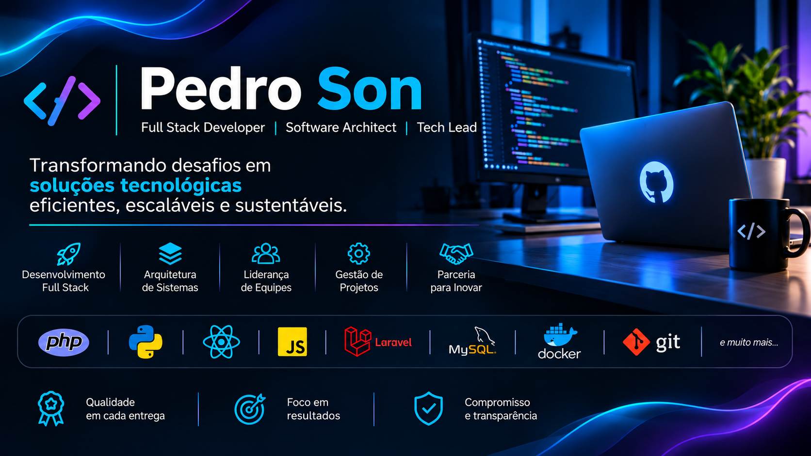

<!-- ================================================= -->
<!-- PEDRO SON | GITHUB PROFILE                        -->
<!-- ================================================= -->

  

<h1 align="center">Olá, eu sou Pedro Son! 👋</h1>

<h3 align="center">
  Full Stack Developer | Software Architect | Tech Lead
</h3>

  
  
  

---

## 🚀 Sobre mim

Sou profissional de tecnologia com sólida experiência em desenvolvimento de software, arquitetura de sistemas, integrações, gestão de projetos e liderança de equipes.

Ao longo da minha trajetória, tive a oportunidade de atuar em empresas como **Linx e Havan**, além de liderar equipes e departamentos de tecnologia, assumindo responsabilidades estratégicas e técnicas equivalentes às de um CTO.

Tenho experiência na concepção, arquitetura e desenvolvimento de sistemas complexos, incluindo plataformas **ERP, LMS e PDV**, integrações entre sistemas, APIs, automação de processos e soluções corporativas.

Meu diferencial está na capacidade de compreender o negócio além da necessidade técnica, transformando problemas reais em soluções eficientes, escaláveis e sustentáveis.

Acredito que tecnologia de qualidade não é apenas sobre código: é sobre resolver problemas, simplificar processos e gerar resultados.

---

## 💻 Tecnologias e ferramentas

  

  
  
  
  

### Principais competências

| Área | Experiência |
|---|---|
| Desenvolvimento Full Stack | Aplicações web e sistemas corporativos |
| Arquitetura de Software | Estruturação e evolução de aplicações |
| APIs e Integrações | Comunicação entre sistemas e serviços |
| Sistemas ERP | Gestão empresarial e processos operacionais |
| Sistemas LMS | Plataformas de gestão de aprendizagem |
| Sistemas PDV | Soluções comerciais e integração de hardware |
| Automação | Otimização de processos e rotinas |
| Gestão de Tecnologia | Estratégia, liderança e direcionamento técnico |

---

## 🧠 Especialidades

  
  
  

- 🚀 Desenvolvimento de aplicações e plataformas digitais.
- 🏗️ Arquitetura e engenharia de software.
- 🔗 Integrações entre sistemas e APIs REST.
- ⚙️ Automação de processos empresariais.
- 📊 Gestão e desenvolvimento de produtos tecnológicos.
- 👥 Liderança e desenvolvimento de equipes.
- 🎯 Planejamento estratégico e gestão de projetos.

---

## 🏢 Experiência profissional

### Linx
**Analista de Sistemas e Líder de Equipe** | Junho/2010 – Setembro/2014

Atuação em análise de sistemas, integração de hardware, implantação de novas tecnologias e coordenação de equipes técnicas.

### Havan
**Analista de Sistemas** | Outubro/2014 – Julho/2016

Gerenciamento de equipes e projetos tecnológicos, com participação na concepção e desenvolvimento de soluções de PDV para postos de combustíveis e lojas de departamentos.

### Fácil Informática
**Líder de Apoio ao Cliente** | Abril/2017 – Dezembro/2024

Liderança de equipe de suporte, gestão de atendimento, relacionamento com clientes, resolução de problemas e melhoria contínua dos processos.

### Propofando Empreendimentos
**Gerente de Departamento de Desenvolvimento** | Dezembro/2024 – Outubro/2026

Liderança estratégica e técnica do departamento de desenvolvimento, com responsabilidades equivalentes às de um CTO.

Gestão de equipes, arquitetura de software, definição tecnológica e condução de projetos de plataformas ERP e LMS.

---

## 🎯 Minha filosofia

Acredito que um bom profissional de tecnologia precisa equilibrar conhecimento técnico, visão de negócio e capacidade de execução.

Meus principais valores:

- **Qualidade:** código limpo, organizado e sustentável.
- **Simplicidade:** soluções eficientes sem complexidade desnecessária.
- **Estratégia:** tecnologia alinhada aos objetivos do negócio.
- **Colaboração:** compartilhar conhecimento e construir em equipe.
- **Comprometimento:** responsabilidade com prazos e entregas.
- **Evolução:** aprendizado contínuo e melhoria constante.

---

## 🤝 Vamos conversar?
Estou aberto a novos desafios, projetos, parcerias e oportunidades profissionais.

Se você procura alguém que consiga compreender uma necessidade de negócio, arquitetar uma solução tecnológica e conduzir sua execução, será um prazer conversar.

  
  

  <strong>Obrigado por visitar meu perfil!</strong>

  ⭐ Transformando desafios em soluções tecnológicas.

